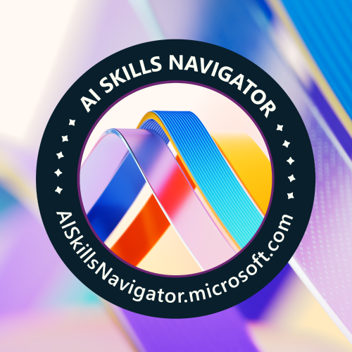
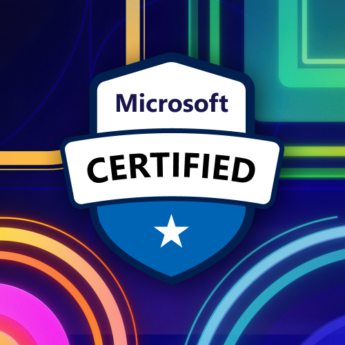

# Skills Hub: Keep up the momentum

Microsoft Ignite may be over, but your learning journey is just getting started. Explore resources to deepen your expertise and turn inspiration into action.

<table>
<tr>
<td valign="top">
<h3>News and announcements</h3>

See <a href="https://aka.ms/ignite26/wepbage/asnannouncementsblog">what's new in AI Skills Navigator</a>. Explore the latest announcements, from AI-powered learning experiences and on-demand labs to personalized guidance, skill validation, and new ways to build expertise.

Explore the latest <a href="https://aka.ms/IgniteNewsSkillingBlog">Microsoft Ignite announcements</a> and uncover curated learning playlists that help you understand, apply, and build skills around each innovation.

</td>
<td width="200" valign="top" align="right">

</td>
</tr>
</table>

<table>
<tr>
<td width="200" valign="top" align="left">

</td>
<td valign="top">
<h3>AI-powered learning for what matters to you with AI Skills Navigator</h3>

Discover learning personalized to your role, goals and interests. Build confidence through realistic scenarios with practice boost, apply what you've learned in free, on-demand labs, and explore skilling playlists tailored to your needs.

<a href="https://aka.ms/ignite26/webpage/ASN">Get started</a>

</td>
</tr>
</table>

<table>
<tr>
<td valign="top">
<h3>Grow your career with Microsoft Credentials</h3>

Earn industry-recognized <a href="https://aka.ms/ignite26/webpage/Credentials">Microsoft Credentials</a> that validate AI, business, and technical skills to help you grow your career.

Show what you can do with GitHub Copilot as you work, no exam required. The <a href="https://aka.ms/igntie26/webpage/probadge">Microsoft Pro Badge</a> verifies your proficiency through real-world tasks and gives you a trusted way to share your skills.

</td>
<td width="200" valign="top" align="right">

</td>
</tr>
</table>

<table>
<tr>
<td width="200" valign="top" align="left">

</td>
<td valign="top">
<h3>Put your skills to work with on-demand labs</h3>

New on-demand labs let you get your hands on the technology and try it for yourself. Experiment, make mistakes, troubleshoot real tasks, and build practical experience and confidence before applying those skills at work.

<a href="https://aka.ms/ignite26/webpage/Labs">Explore labs</a>

</td>
</tr>
</table>

## Additional Resources

- [Skills for AI resources](https://www.microsoft.com/en-us/events/local-events/skillsforairesources) - Explore learning resources that helps you innovate, work smarter, strengthen security, modernize technology, and unlock more value from your data and AI.
